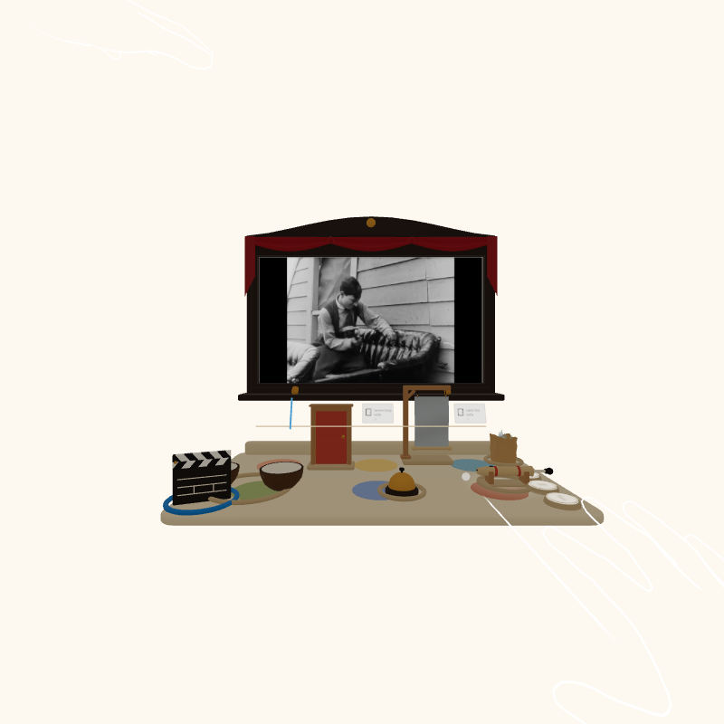

# Coconuts: be the sound of a silent movie

A hands-first mixed-reality toy for Meta Quest and Meta VR Glasses, built on Meta's Immersive Web SDK (WebXR).
A public-domain silent film plays on a little proscenium in front of you; a beech table of toy foley props sits
within reach. You make the sound effects with your hands, in time with the picture, then play your take back
with the film and send the link to a friend.

Live: https://coconuts-foley.vercel.app (open it in the Quest browser; any browser shows a sample take).
Video: a 2:51 cut is ready for upload (the public link goes here).



Built from scratch inside the Meta VR Start Developer Competition window: the first commit (ca173c2) is
timestamped 2026-11-10T17:13:38Z, after the build opened on 24 September 2026. Entertainment track, New
Experience division.

## What is real

| Piece | State |
|---|---|
| Six props, each a hand interaction, with synthesised spatial sound and a replayable take | real, in the build |
| The three films and their cue sheets | real public-domain prints, cue sheets proposed by Gemini and checked by hand |
| The Director's one-line review and voice | real model calls with a validator; a rule-written line stands in when the model is slow or absent |
| The sample take on the landing page | scripted from the cue sheet by `tools/make-demo-take.mjs`, labelled as such |
| Headset testing | the IWSDK desktop emulator only (Quest 3 and Meta VR Glasses profiles); no physical headset was available |

## How it plays

1. **Enter in your headset.** The table appears 75 cm ahead, the screen above it. The Director's paper tag says
   what is coming up ("Doors in this one. Mind the slam.").
2. **Pinch the clapperboard.** The film rolls and the cue lane under the screen slides pictogram cards toward
   the now line: a horse, a door, a fall.
3. **Make the sounds.** Each prop is a real hand interaction, and every prop also answers a far pinch (or a
   gaze and a pinch on the glasses) with its one-shot:

   | Prop | In the hand | One-shot |
   |---|---|---|
   | Coconut shells | pinch to hold, shake down: a clop on each strike, left and right shells alternate | clop |
   | Little door | tap: knock; hold a third of a second: slam (the leaf swings) | knock |
   | Desk bell | poke or pinch the button | ding |
   | Thunder sheet | hold the handle and shake: the rumble follows your speed, the sheet shivers | rumble |
   | Slide whistle | hold and pull up or down: the pitch follows your hand, the slide moves | whistle |
   | Bag of glass | hold, lift, let go: a crash if it drops from height | crash |

   Tiles on the table rim pause the film, step the volume and redo the take.
4. **Play it back.** When the reel ends the slate says how many cues you hit, the Director gives you one line
   ("“couple runs in panic” landed, and “train whistle blows” never came."), and the clapperboard replays the
   film with your sounds. The take's code lands in the address bar: `/#take=<code>` replays it anywhere, and
   a shared take says "Your turn."

   Hits count the prop and the moment: a cue is hit when its prop sounds inside the cue's window, however the
   sound was made. The lane never shows a miss in red.

All sounds are synthesised in Web Audio and spatialised from the prop's position; nothing is sampled.

## The Director

Two things in the game come from a model, and the game stands without either:

- The **cue sheets** for the three bundled clips were proposed by Gemini watching each clip
  (`tools/cue-sheet.mjs`), then hand-checked; every cue carries its provenance in `public/clips/*.json`.
- After a take, `POST /api/director` asks Gemini for one in-character line about your take: a reviewer with a
  fact-checking guard, not an agent. The line is validated before it is shown: it may only name cues and props
  that were in the take, only the numbers the take has, and it may only call something late or early when the
  take's timing says so. Anything else, a slow answer (2.2 s in the function, 2.5 s end to end), a rate limit or
  no key at all, and a rule-written line takes its place. `GET /api/tts` speaks the line.

The raw cue proposals the model made are kept beside the checked sheets as `public/clips/*.proposed.json`.

## The films

| Clip | Year | Source | Length |
|---|---|---|---|
| One Week (Buster Keaton) | 1920 | archive.org item OneWeek1920 | 2:00 |
| Safety Last! (Harold Lloyd), the clock | 1923 | archive.org item safety-last-1923 | 2:00 |
| A Trip to the Moon (Georges Méliès) | 1902 | archive.org item ATripToTheMoonGeorgeMelies | 2:00 |

Original prints, US public domain (published before 1929), trimmed and credited on the landing page. The
`tools/films/` scripts rebuild the MP4 and WebM files from the originals.

## Run it

```bash
npm install
npm run dev         # the IWSDK dev runtime with the desktop emulator (Quest 3 profile)
npm run build       # static site in dist/ plus the Vercel functions in api/
npm test            # 85 unit tests: triggers, cues, replay, the Director, shipped data
```

The functions need `GEMINI_API_KEY` in the environment; without it the Director answers from the rules and the
health probe reports it.

### Scripted emulator runs

With `npx iwsdk dev up --ai-mode agent --allow-browser-automation --headless` running:

```bash
node tools/xr/run-take.mjs --until review --state offline   # the judge path: clapper, four hits, the reel ends, the review
node tools/xr/run-props.mjs                                 # every prop driven by a natural hand (grab, shake, pull, drop, press)
node tools/xr/run-props.mjs --glasses                       # the same by gaze and pinch (set dev.emulator.device to metaVRGlasses)
node tools/xr/run-take.mjs --until start --perf             # the stage dressed with its models, draw calls counted
```

The headless emulator renders in software; the app notices automation (`navigator.webdriver`) and draws small,
without shadows or audio, so hand motion is sampled often enough to test. Nothing of that runs on a headset.

## How it is built

- `src/foley/system.ts`: the one ECS system. Places the stage for the player's eyes, turns pinches, pokes and hand
  motion into hits, records and replays takes, runs the tiles and the Director's tags.
- `src/foley/triggers.ts`: pure motion detectors (strike, shake, slide, drop) with tests on synthetic traces.
- `src/foley/sound.ts`: the Web Audio foley kit. `src/foley/recorder.ts`: the take and its share code.
- `src/foley/stage.ts`, `toys.ts`, `models.ts`: the table, props and screen; primitives first, Blender models
  (`assets-src/build_props.py`, deterministic) dress them as they load.
- `src/foley/cues.ts`, `lane.ts`, `bubble.ts`: the cue sheet, the lane and the paper tags.
- `src/landing/`: the page around the engine. `api/`: the Director, the voice, the health probe.

Hands only, no controllers. Seated, everything inside a two-foot radius. 78 draw calls.

## Accessibility

- One hand is enough: every prop answers a single far pinch with its one-shot, and the clapperboard and tiles
  are pinch targets. Nothing needs both hands or a controller.
- Eyes do the aiming on Meta VR Glasses: look at a prop and pinch once with either hand.
- Seated and stationary: the table is 75 cm ahead and 25 cm below the eyes; nothing is above eye level
  except the top of the screen, and nothing leaves the glasses' view.
- The cue lane is a visual channel for every cue, and a landed cue lights its card; the volume tile mutes
  the effects in three steps and the pause tile holds the film.
- The landing page replays any take in a plain browser with no headset.

## Testing

85 unit tests (motion detectors on synthetic traces, cue windows, replay determinism, the Director's
validator and fallbacks, shipped data) and scripted emulator runs through the IWSDK CLI (every prop by hand
and by gaze, the full judge path to the review, the draw-call count). The live site has a health probe.

## Licence

MIT for the code (see `LICENSE`). The films are public domain; see each clip's provenance.
